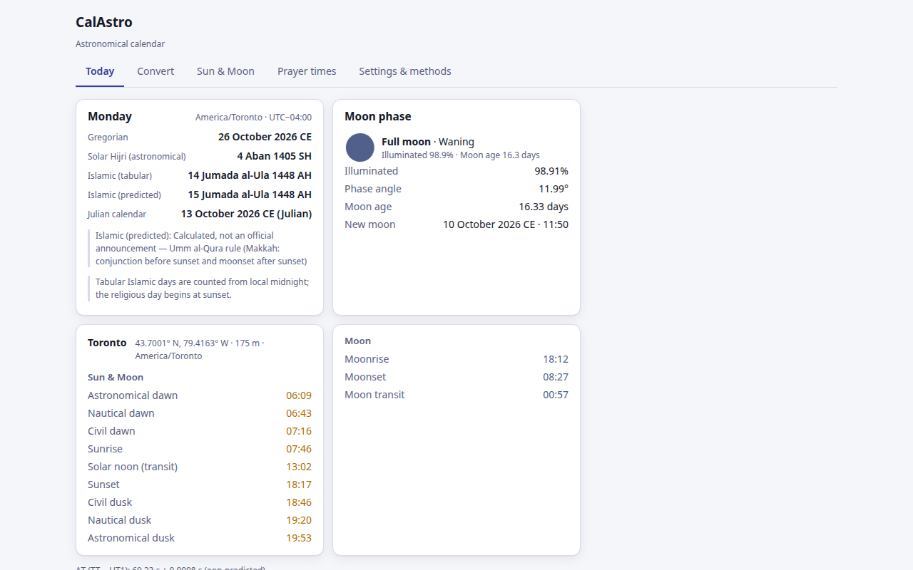

# CalAstro

**Astronomical calendar, Sun and Moon times, and prayer times, in your browser and offline.**

CalAstro is a free Chrome extension that converts dates between calendars and shows the day's
Sun and Moon events and prayer times for any place. Every calculation runs on your device,
from the original JPL DE442 ephemeris packaged with the extension.

> Chrome Web Store: _link added at publication_ · Website: https://reza-ghazi.github.io/calastro/

## Features
- **Calendar conversion** in any direction:
  - Gregorian;
  - Julian calendar;
  - **Solar Hijri, astronomical**: the year starts at the March equinox under the official
    true-noon rule of the University of Tehran Calendar Center;
  - Shahanshahi (Imperial);
  - **tabular Islamic** (four historical leap-year variants, two epochs);
  - **predicted Islamic**: the Umm al-Qura rule, or crescent visibility by the Yallop or Odeh
    criterion at Makkah or at your location.
- **Today:** the date in your chosen calendars, the weekday, the time zone and the ΔT in use.
- **Sun and Moon:** rise, set and meridian transit; civil, nautical and astronomical
  twilight; explicit "up all day" and "down all day" states for polar days and nights.
- **Moon phase:** illumination, phase angle, waxing or waning, named phase, and lunar age
  measured from the last new moon.
- **Prayer times:** 18 calculation methods with their sources shown (MWL, ISNA, Egypt,
  Karachi, Umm al-Qura, Diyanet, JAKIM, MUIS, Kemenag, Tehran Institute of Geophysics, Leva Qum,
  and others). Also Asr school, high-latitude rules, Ramadan timetables, and the Qibla bearing.
- **English and Persian** interface, with correct right-to-left layout, Persian or Latin
  numerals, and light and dark themes.
- **Private by design:** no account, no analytics, no server. Location is used only on your
  device. See [PRIVACY.md](PRIVACY.md).

## Accuracy
CalAstro's results are tested against independent references. Selected results (details in
[docs/validation.md](docs/validation.md)):

| Quantity | Reference | Agreement |
|---|---|---|
| Sun and Moon positions (azimuth and altitude, 1000 epochs, 4 sites, 1985–2026) | NASA NAIF SPICE with the ITRF93 high-precision Earth model | **0.009″** |
| Rise, set, transit and twilight (126 events, incl. polar day and night) | US Naval Observatory | every time rounds to USNO's minute |
| Solar Hijri year starts, 1206–1498 SH | University of Tehran Calendar Center (official table) | **293 of 293 years** |
| Umm al-Qura months, 1423–1450 AH | KACST official table | 335 of 336 months |
| Prayer times, İstanbul, 403 days | Diyanet (official timetable) | Fajr, sunrise, Dhuhr and Asr within ±1 min |

Calculated Islamic dates and crescent predictions are **calculations, not official
announcements**. Displayed times are rounded to the minute. Real atmospheric refraction can
change sunrise and sunset by more than that.

## Supported range
- **Arithmetic calendars:** 1–9999 CE.
- **Sun, Moon and prayer times:** 1550–2649 CE.
- **Astronomical Solar Hijri:** 929–2027 SH.

## Documentation
- [User guide](docs/user-guide.md)
- [Methods](docs/methods.md)
- [Validation summary](docs/validation.md)
- [Release notes](CHANGELOG.md)

## Support
See [SUPPORT.md](SUPPORT.md). Questions about a calculation are welcome as issues. For private
matters, email contact@brightarcadia.com.

## License
CalAstro is proprietary software, free to use as published. This repository contains its
documentation and website, not its source code. See [LICENSE](LICENSE) and
[THIRD_PARTY_NOTICES.md](THIRD_PARTY_NOTICES.md).
